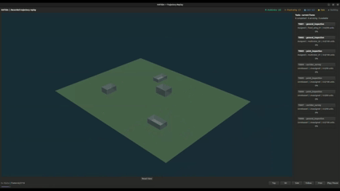

# HATSim



**Heterogeneous Autonomous Teams Simulator** — an open-source, lightweight Python simulation and benchmark environment for multirotor UAVs, fixed-wing aircraft, and unmanned ground robots performing dynamically arriving service tasks.

**Status: experimental research prototype** (Python package version `0.1.0`; under active development). HATSim uses simplified kinematic dynamics; it is not an aerodynamically accurate or safety-certified simulator.

## Repository layout

```text
HATSim/
├── assets/
│   └── hatsim.gif                 # README demo animation
├── hatsim/                       # Simulator, CLI, engine, GUI, logging
├── policies/
│   ├── registry.py               # Discovers policy folders
│   ├── highest_reward/main.py    # Greedy baseline
│   ├── sticky/main.py            # Sticky-commitment baseline
│   ├── reward_per_task/main.py   # Example robot-task scoring baseline
│   └── my_policy/                # Add your own folder
│       ├── __init__.py
│       └── main.py
├── configs/
│   ├── default.yaml
│   └── task_sequences/
│       ├── seq_001.yaml          # Seeded, dynamically arriving tasks
│       └── seq_002.yaml          # Additional sequence, if installed
├── tests/
├── logs/                         # Numbered runs (not committed)
└── pyproject.toml
```

The `seq_002.yaml` entry is an example of an additional sequence; only sequences actually present in `configs/task_sequences/` can be selected.

## Installation

Run the following commands from the repository root. **Python 3.11** is recommended.

### Conda (recommended)

```bash
conda create -n hatsim python=3.11 -y
conda activate hatsim
cd ~/Downloads/projects/HATSim  # Or the directory where you cloned HATSim
python -m pip install -e '.[gui,test]'
```

### Python virtual environment (alternative)

```bash
python3 -m venv .venv
source .venv/bin/activate
python -m pip install -e '.[gui,test]'
```

The base simulator runs headlessly without GUI dependencies. For a minimal installation, use `python -m pip install -e .`. Optional multi-agent RL adapter dependencies: `python -m pip install -e '.[marl]'`.

**Linux Qt troubleshooting:** If the GUI reports an `xcb` / `libxcb-cursor` error, install your distribution's `libxcb-cursor` system package (for example, `sudo apt install libxcb-cursor0` on supported Ubuntu/Debian versions).

**ROS 2 environment troubleshooting:** If your shell inherits a ROS Python path such as `/opt/ros/jazzy/lib/python3.12/site-packages`, run tests without auto-loading unrelated ROS pytest plugins:

```bash
PYTEST_DISABLE_PLUGIN_AUTOLOAD=1 python -m pytest -q
```

## Run a simulation

List the installed policies:

```bash
python -m hatsim.cli --list-policies
```

Run a reproducible headless experiment with six robots, dynamically arriving tasks, and a 300-second episode timeout:

```bash
python -m hatsim.cli \
  --headless \
  --world industrial_campus \
  --task-sequence 1 \
  --arrival-window 60 \
  --timeout 300 \
  --multirotors 2 \
  --fixed-wings 1 \
  --ugvs 3 \
  --policy highest_reward \
  --seed 42
```

Run another policy on the **same task stream** by retaining the world, task sequence, seed, and arrival-window settings:

```bash
python -m hatsim.cli \
  --headless --world industrial_campus \
  --task-sequence 1 --arrival-window 60 --timeout 300 \
  --multirotors 2 --fixed-wings 1 --ugvs 3 \
  --policy sticky --seed 42
```

`--task-sequence` selects a task definition from `configs/task_sequences/` (for example, `1` selects `seq_001.yaml`). Generated sequences use a task RNG separate from robot spawning, making task arrivals and task attributes reproducible across policies for a fixed world and seed. Explicit YAML sequences can specify precise task arrivals. `--arrival-window` controls **when new tasks may appear**; `--timeout` is the maximum total simulated episode time, **300 s by default**. A run may finish earlier once all tasks are completed or expired and no scheduled tasks remain. For compatibility, `--duration` is supported as a legacy arrival-window option; prefer `--arrival-window` and `--timeout` in new experiments.

Available worlds depend on the installed `configs/worlds/` files; examples include `industrial_campus`, `logistics_yard`, `open_terrain`, and `urban_inspection`. If the wide-area update has been applied, `wide_survey` is also available.

### Replay an experiment

Each simulation writes a new numbered directory, such as `logs/0001/`, without overwriting earlier runs. Use the `log_directory` printed at the end of the run:

```bash
python -m hatsim.cli --replay logs/0001 --gui
```

Replay reads recorded task states, robot positions, events, and metrics; **it does not rerun the physics or the selected policy**. The 3D GUI includes camera presets, playback controls, task progress, and task-focused views (when the latest GUI patch is installed). A Matplotlib fallback is available without the optional Qt viewer.

## Custom policies

HATSim supports one policy per directory. To collaborate on a new baseline, create a folder under `policies/` containing a `main.py` with a **`select_actions(sim)`** function. Other files are optional and can hold scoring formulas, helpers, checkpoints, or configuration.

### 1. Create a policy folder

```bash
mkdir -p policies/my_policy
touch policies/my_policy/__init__.py
```

### 2. Implement `select_actions(sim)`

Create `policies/my_policy/main.py`:

```python
import numpy as np


def select_actions(sim):
    """Return one proposed action per alive robot."""
    actions = {}
    for robot in sim.robots:
        if not robot.alive:
            continue

        candidates = [
            task for task in sim.tasks
            if task.status in ("available", "assigned", "servicing")
            and task.owner in (None, robot.id)
            and task.eligible(robot.kind)
        ]
        if not candidates:
            actions[robot.id] = "keep"
            continue

        # Example reward-rate score, not an optimized task allocator.
        def score(task):
            travel_time = np.linalg.norm(
                np.asarray(task.position) - robot.position
            ) / max(float(robot.spec["cruise_speed"]), 0.01)
            service_time = max(task.total_work - task.progress, 0.0) / task.rates[robot.kind]
            return task.reward / max(travel_time + service_time, 0.01)

        target = max(candidates, key=lambda t: (score(t), t.id))
        actions[robot.id] = (
            "keep" if robot.task_id == target.id else f"claim:{target.id}"
        )
    return actions
```

The function returns a `dict` mapping each robot ID to an action string:

| Action | Meaning |
|---|---|
| `"keep"` | Maintain the current commitment (or remain idle) |
| `"release"` | Release the current task |
| `"claim:T0004"` | Request task `T0004` |

A policy is called once per allocation period (2 seconds by default). **Do not change `sim` or task/robot state from a policy**—return actions and let the simulator handle claim resolution, navigation, servicing, handovers, and collisions. The engine allows only one task owner, so simultaneous claims may be rejected. The existing greedy policies retain their original behavior; a losing robot is not automatically given its next choice in the same round.

### 3. Discover and run the policy

```bash
python -m hatsim.cli --list-policies

python -m hatsim.cli \
  --headless --policy my_policy \
  --world industrial_campus \
  --task-sequence 1 --seed 42 \
  --arrival-window 60 --timeout 300
```

No changes to `hatsim/engine.py`, `hatsim/cli.py`, or the registry are required for a valid policy directory. See `policies/reward_per_task/main.py` for an additional scoring-policy example. For fair comparisons, use **identical world, fleet, seed, task sequence, timeout, and arrival window** for each policy, and evaluate over multiple seeds.

**Current API limitation:** `select_actions(sim)` exposes the simulator's full task and robot state, so it is appropriate for **full-information baselines**. It is **not** yet a decentralized observation interface. Communication-constrained PACT policies should eventually use per-agent observations and local commitment beliefs rather than the global `sim` object.

## Simulated behavior

- YAML-defined multirotor UAV, fixed-wing UAV, and UGV capabilities, motion constraints, energy budgets, and LiDAR mounts.
- Configurable 3D environments with solid obstacle collision volumes.
- A* navigation for multirotors and UGVs and simplified rate-limited fixed-wing motion.
- Robot–robot and robot–obstacle collision checks, with robot destruction events.
- Dynamic task discovery/arrival schedules, rewards, deadlines, scalar work progress, and per-platform service rates.
- Single-owner task commitments, releases, handovers, and cross-platform progress retention losses.
- Pluggable policies and repeatable task sequences for baseline evaluation.
- Recorded trajectories, events, task histories, metrics, and offline 3D replay.
- Optional raycast LiDAR module (not in the default control loop) and a preliminary PettingZoo adapter (`.[marl]`).

## Known limitations

1. Fixed-wing navigation is not yet globally Dubins-feasible; loitering and tight turns may prevent successful servicing, particularly on small maps.
2. Obstacle avoidance remains simplified; collisions are possible even with conservative local control.
3. Sensor data does not yet drive perception-aware navigation or genuine local task discovery; task availability is currently represented by scripted/seeded arrivals.
4. Tasks use scalar work units rather than verified geometric coverage. Fixed-wing service is approximated by proximity to a service region.
5. Dynamics are kinematic, without full aerodynamic forces, wind, or detailed terrain mechanics.
6. The GUI is designed for **recorded replay**, not interactive control of a live running simulation.
7. The optional multi-agent RL interface is preliminary; the repository does not contain a trained MAPPO policy or an established MAPPO training pipeline.
8. Communication-constrained task discovery and the proposed fixed-wing relay are research directions, **not implemented features** of this version.

## Tests

```bash
PYTEST_DISABLE_PLUGIN_AUTOLOAD=1 python -m pytest -q
```

## License

MIT. Research prototype; no warranty.
